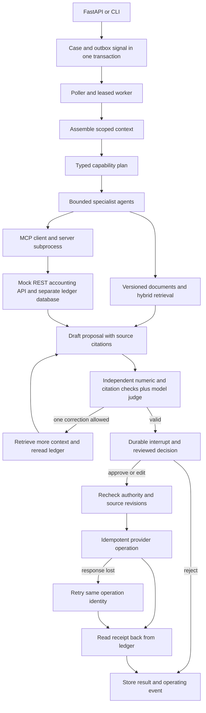

# Agentic AI patterns

An invoice investigation service built from nine inspectable AI engineering patterns. It reads an accounting ledger through MCP, retrieves policy, proposes a credit, waits for a reviewed decision and verifies the resulting accounting entry. It also recovers when a worker loses the response after the accounting service commits.

**Start with the implementation:** [workflow graph](deterministic-workflow-with-subagents/graph.py), [agent runtime](agents-as-tools/agent.py), [application service](application/service.py), or [end-to-end acceptance cases](tests/test_application.py).

## Run in 60 seconds

Python 3.15 is the default; Python 3.11 and later are supported. Install [uv](https://docs.astral.sh/uv/), then:

```bash
uv python install 3.15
uv sync --locked --extra dev
uv run agent-patterns walkthrough
```

The walkthrough uses a fresh temporary workspace and performs these actual operations:

```text
Invoice total:           12000 cents
Two booked payments:     24000 cents
Proposed credit:         12000 cents
Reviewed edit:           10000 cents
Accounting commit:       succeeds
Injected response loss:  worker retries
Verified credit entries: 1
Final outcome:           completed, receipt verified
```

The CLI prints the proposal, decision, provider receipt, shared work document and event trail. All records are synthetic. Model inference is scripted by default; graphs, tools, ingestion, database operations, approvals, MCP transport and recovery execute normally. [What the fixture model does](docs/PROVIDERS.md).

```bash
uv run python scripts/verify.py
```

These run adversarial acceptance checks, all nine focused demos and an actual localhost HTTP lifecycle. Dependency download time depends on the connection. [Recorded validation](docs/VALIDATION.md).

## Architecture



## Read the code by pattern

Each folder contains its implementation, runnable demo and tests. `demo.py` is the entry point; the files below contain the mechanism. The integrated application uses the same code.

| Pattern | Open the implementation | Problem solved |
| --- | --- | --- |
| [Fixed workflow with sub-agents](deterministic-workflow-with-subagents) | [graph.py](deterministic-workflow-with-subagents/graph.py), [specialists.py](deterministic-workflow-with-subagents/specialists.py) | Keep business stages fixed while specialists choose tools inside a bounded loop |
| [Router and orchestrator](router-and-orchestrator) | [planner.py](router-and-orchestrator/planner.py) | Validate stable job IDs, dependency order and result binding before dispatch |
| [Agents as tools](agents-as-tools) | [agent.py](agents-as-tools/agent.py) | Expose specialist agents through typed tools with shared budgets |
| [Context management](context-management) | [context.py](context-management/context.py) | Assemble scoped context and persist turns and reviewed memories |
| [RAG with evals](rag-pipeline-with-evals) | [knowledge.py](rag-pipeline-with-evals/knowledge.py), [evals.py](rag-pipeline-with-evals/evals.py) | Replace stale document generations, retrieve cited chunks and compare retrieval methods |
| [REST API to MCP](mcp-server-from-rest-api) | [compiler.py](mcp-server-from-rest-api/compiler.py), [server.py](mcp-server-from-rest-api/server.py), [erp.py](mcp-server-from-rest-api/erp.py) | Translate OpenAPI parameters and referenced request bodies into validated tools |
| [Human approval](human-in-the-loop-approval) | [approval.py](human-in-the-loop-approval/approval.py) | Persist approve/edit/reject decisions bound to exact tool arguments |
| [Event-driven jobs](event-driven-job-runner) | [queue.py](event-driven-job-runner/runner.py), [work_document.py](event-driven-job-runner/work_document.py) | Coordinate workers with outbox signals, leases, fencing and evidence-backed progress |
| [Evaluator retry loop](evaluator-retry-loop) | [evaluator.py](evaluator-retry-loop/evaluator.py), [graph nodes](deterministic-workflow-with-subagents/graph.py) | Correct missing evidence once, then block an unsupported action |

The hyphenated folder names map to importable Python packages in [pyproject.toml](pyproject.toml). There are no duplicate hidden implementations. `patterns/` contains shared model and database infrastructure. `application/` supplies orchestration, HTTP and CLI entry points.

## Failure cases to inspect

- [Fresh-process resume, rejection, response loss, source drift and tenant isolation](tests/test_application.py).
- [Concurrent claims, late owners, phase serialization and poller batch starvation](event-driven-job-runner/test_jobs.py).
- [Invalid edits, expired approvals and exact argument binding](human-in-the-loop-approval/test_approval.py).
- [Live MCP handshake, JSON body schemas and provider-side idempotency](mcp-server-from-rest-api/test_mcp.py).
- [Stale chunk replacement, metadata generation checks and retrieval ablations](rag-pipeline-with-evals/test_rag.py).

## Use and tradeoffs

These patterns fit internal support, reconciliation and operations assistants that read company systems and propose changes for review. The accounting service is a local sandbox. Workspace headers demonstrate scope enforcement; they are not production authentication.

SQLite makes the persistence and transaction boundaries easy to inspect. A deployed service would need a trusted identity adapter, a multi-host database, retention controls and evaluation against its own records and selected model. Provider idempotency and receipt reconciliation are essential: a checkpoint cannot make a remote API call exactly once.

[Operate the service](application/README.md) | [Design decisions](docs/DECISIONS.md) | [Optional model providers](docs/PROVIDERS.md) | [MIT license](LICENSE)
